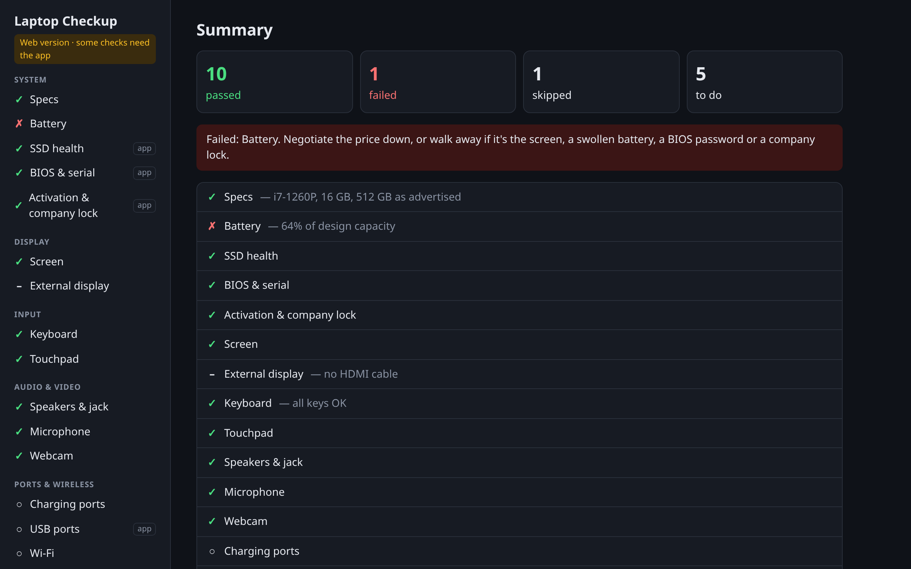
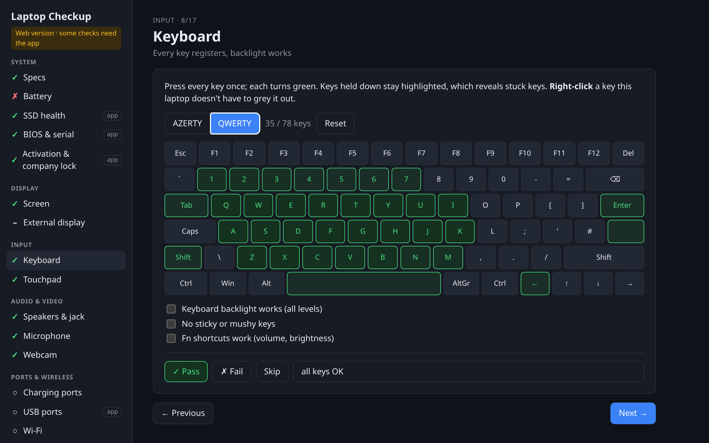
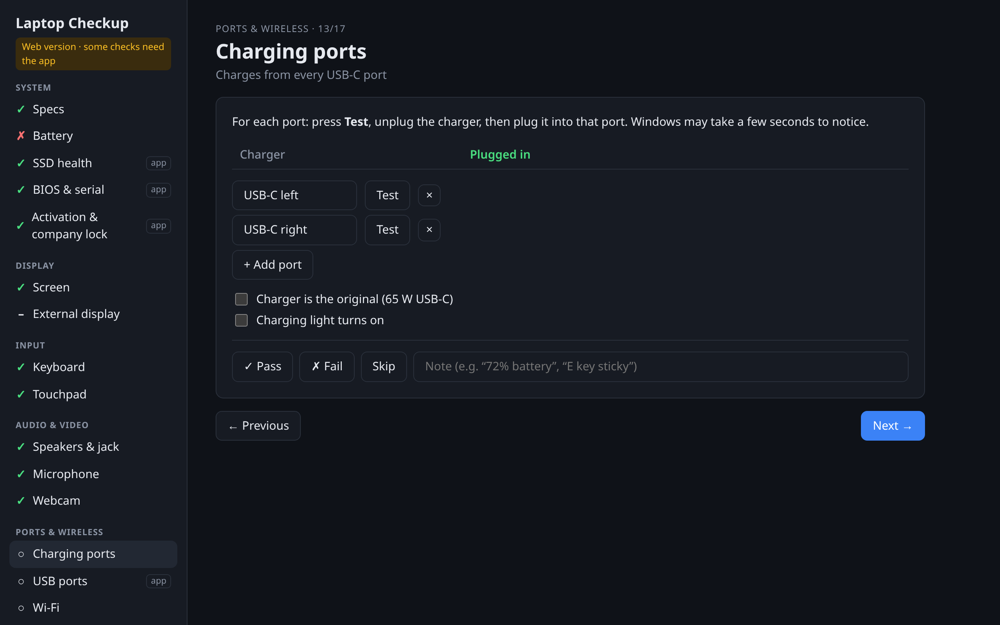

# Laptop Checkup

A checklist app for inspecting a used laptop before buying it: keyboard, screen
(dead pixels, OLED burn-in), touchpad, speakers, mic, webcam, ports, Wi-Fi,
Bluetooth, battery wear, SSD health, BIOS password and company (Autopilot/Intune)
locks. Tick each test, then copy a one-page report.

**Try it:** [checkup.goris.live](https://checkup.goris.live) ·
[GitHub Pages mirror](https://axelgoris99.github.io/laptop-checkup/) ·
[Windows .exe](https://github.com/Axelgoris99/laptop-checkup/releases/latest)



| Keyboard test | Charging per USB-C port |
|---|---|
|  |  |

Two builds from one React UI:

| | Web version | Desktop app (Tauri) |
|---|---|---|
| Keyboard, touchpad, screen, audio, webcam, mic | ✅ | ✅ |
| Charging per USB-C port, HDMI, Wi-Fi, Bluetooth | ✅ Chrome / Edge | ✅ |
| Exact specs, battery wear, SSD health | ❌ | ✅ |
| BIOS / serial, Windows activation, company lock | ❌ | ✅ (Windows) |
| Data on every USB port (incl. USB-A) | ❌ | ✅ |

Tests the web version can't run show the manual steps instead.

## Develop

```bash
bun install
bun run dev          # web version on http://localhost:5173
bun tauri dev        # desktop app
```

Rust tests: `cd src-tauri && cargo test`. To print what the native commands
return on your machine: `cargo test probe -- --ignored --nocapture`.

## Build

- **Windows .exe**: push a `v*` tag. The *Desktop build* workflow attaches a
  portable `laptop-checkup.exe` (runs from a USB stick) and an installer to a
  GitHub Release. Running it manually only uploads them as run artifacts.
  Unsigned, so Windows SmartScreen will warn: *More info → Run anyway*.
- **Web**: the *Web version* workflow publishes `dist/` to GitHub Pages.

Run the desktop app **as administrator** to read SSD wear and temperature.

## Layout

```
src/core/       types, Tauri bindings (native.ts), media helpers
src/tests/      one component per check, registered in tests/index.ts
src-tauri/src/  system.rs (specs, battery, disks, BIOS, Windows status)
                devices.rs (USB, Wi-Fi, Bluetooth), shell.rs (PowerShell helper)
```
